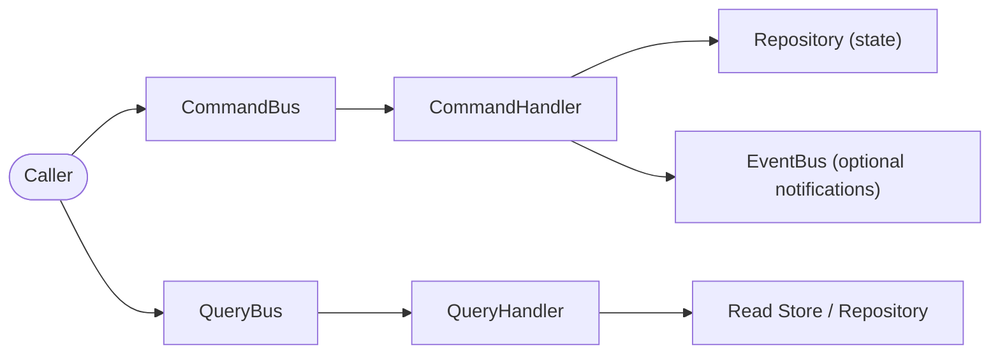
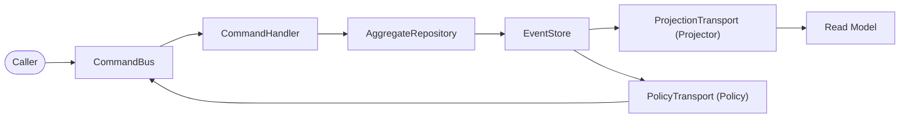

# CQRS & Event Sourcing Architecture

KmpKt is **modulith-first**: features live in separate Kotlin modules wired at compile time through `kmpkt-di` ports and decorators, communicating via typed messages instead of reaching into each other's internals. On top of that boundary, KmpKt separates **CQRS / Messaging** from **Event Sourcing** — you can adopt only the buses for command/query separation, or add the event store, projections, and policies where auditability or decoupled read models matter.

## CQRS without Event Sourcing

When your domain state is simple CRUD or stored directly in a table/document:

- **Modules**: `kmpkt-di`, `kmpkt-command-bus`, `kmpkt-query-bus`, `kmpkt-event-bus`
- **Example**: [`examples/todo-cqrs`](../examples/todo-cqrs)

## CQRS with Event Sourcing

When you want an append-only audit log of domain events, decoupled read models, and reactive policies:

- **Write side**: `CommandHandler` loads an `AggregateRoot` via `AggregateRepository`, invokes domain behavior, and persists new `DomainEvent`s to `EventStore`.
- **Read side**: `Projector`s consume events from `EventStore` via `ProjectionTransport` and update read models (`ProjectionStore` or SQL tables). `QueryHandler`s read from those models.
- **Reactions**: `Policy` instances react to `DomainEvent`s via `PolicyTransport` and dispatch follow-up commands on `CommandBus`.
- **Example**: [`examples/todo-event-sourced`](../examples/todo-event-sourced)

## Modularity & Cross-Cutting Concerns

As an application grows, cross-cutting concerns like auditing, telemetry, or feature flags stay in independent modules and wrap core ports at compile time using `kmpkt-di` decorators:

- **Example**: [`examples/modulith`](../examples/modulith)
