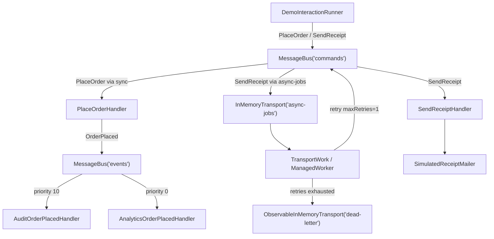

# messenger

A multi-bus messaging example built with `kmpkt-messenger`, `kmpkt-worker`, and `kmpkt-di`. It demonstrates typed message buses with distinct handler policies, correlation middleware, per-message async transport routing, priority-ordered event listeners, automatic retries, dead-lettering, and managed background workers.

## Flow



## How It Works

### 1. Define Messages and Middleware

Commands (`PlaceOrder`, `SendReceipt`) and events (`OrderPlaced`) implement `Message`. Every envelope entering the `"commands"` bus passes through `CorrelationMiddleware`, which attaches a `CorrelationStamp` if one is not already present so initial dispatches and async retries can be traced in logs.

```kotlin
class CorrelationMiddleware(
    private val logger: Logger,
) : Middleware {
    private val sequence = AtomicInteger(0)

    override suspend fun handle(envelope: Envelope, next: MiddlewareChain): Envelope {
        val tagged =
            if (envelope.last<CorrelationStamp>() == null) {
                val id = "corr-${sequence.incrementAndGet()}"
                logger.info("correlation: $id")
                envelope.with(CorrelationStamp(id))
            } else {
                envelope
            }
        return next(tagged)
    }
}
```

### 2. Configure Buses, Transports, and Retries

`MessengerExampleConfiguration` defines three transports (`dead-letter`, `async-jobs` with `MultiplierRetryStrategy(maxRetries = 1, delay = 10.milliseconds)`, and `sync`) and two buses:

- **`commands`** (the default bus): runs `CorrelationMiddleware`, handles `PlaceOrder` synchronously, and routes `SendReceipt` to `async-jobs`.
- **`events`**: uses `HandlerPolicy.MULTIPLE` so multiple listeners react to `OrderPlaced` in priority order (`AuditOrderPlacedHandler` at priority `10` before `AnalyticsOrderPlacedHandler` at priority `0`).

```kotlin
messenger {
    val deadLetter = transport<ObservableInMemoryTransport>("dead-letter")
    val asyncJobs =
        transport<InMemoryTransport>("async-jobs") {
            retry<MultiplierRetryStrategy> {
                maxRetries = 1
                delay = 10.milliseconds
            }
            failureTransport = deadLetter
        }
    val sync = transport<SyncTransport>("sync")

    defaultBus =
        bus("commands") {
            defaultTransport = sync
            middleware<CorrelationMiddleware>()
            route<SendReceipt>(asyncJobs)
        }

    bus("events") {
        policy = HandlerPolicy.MULTIPLE
        defaultTransport = sync
    }
}
```

### 3. Run Background Workers Before Client Traffic

`TransportWork` consumes messages from `"async-jobs"`, dispatches them back through `"commands"`, and forwards exhausted messages to `"dead-letter"`. `WorkerComponent` wraps it into a `ManagedWorker`, and `MessengerWorkerRunner` (priority `100`) starts all workers before `DemoInteractionRunner` (priority `0`) begins sending traffic.

### 4. Observe Sync Fan-Out, Retries, and Dead-Lettering

`DemoInteractionRunner` dispatches three commands:

- `PlaceOrder("ord-42", 99, "alice")` runs inline and fans out `OrderPlaced` to both audit and analytics handlers.
- `SendReceipt("ord-42")` fails on its first attempt in `SimulatedReceiptMailer` (simulating a transient SMTP timeout) and succeeds on retry `#2`.
- `SendReceipt("ord-broken")` fails permanently, exhausts its retry budget, and is routed to `ObservableInMemoryTransport("dead-letter")`.

## Project Layout

| File | Role |
| --- | --- |
| [`PlaceOrder.kt`](core/src/main/kotlin/io/kmpkt/example/messenger/domain/command/PlaceOrder.kt), [`SendReceipt.kt`](core/src/main/kotlin/io/kmpkt/example/messenger/domain/command/SendReceipt.kt), [`OrderPlaced.kt`](core/src/main/kotlin/io/kmpkt/example/messenger/domain/event/OrderPlaced.kt) | Command and event messages |
| [`CorrelationMiddleware.kt`](core/src/main/kotlin/io/kmpkt/example/messenger/inbound/bus/CorrelationMiddleware.kt) | Middleware attaching `CorrelationStamp` |
| [`PlaceOrderHandler.kt`](core/src/main/kotlin/io/kmpkt/example/messenger/application/handler/PlaceOrderHandler.kt), [`SendReceiptHandler.kt`](core/src/main/kotlin/io/kmpkt/example/messenger/application/handler/SendReceiptHandler.kt) | Command handlers |
| [`AuditOrderPlacedHandler.kt`](core/src/main/kotlin/io/kmpkt/example/messenger/application/handler/AuditOrderPlacedHandler.kt), [`AnalyticsOrderPlacedHandler.kt`](core/src/main/kotlin/io/kmpkt/example/messenger/application/handler/AnalyticsOrderPlacedHandler.kt) | Priority-ordered event handlers |
| [`SimulatedReceiptMailer.kt`](core/src/main/kotlin/io/kmpkt/example/messenger/outbound/mail/SimulatedReceiptMailer.kt), [`ObservableInMemoryTransport.kt`](core/src/main/kotlin/io/kmpkt/example/messenger/outbound/transport/ObservableInMemoryTransport.kt), [`ObservableLogger.kt`](core/src/main/kotlin/io/kmpkt/example/messenger/outbound/logger/ObservableLogger.kt) | Outbound mail simulator, dead-letter transport, and in-memory log |
| [`MessengerExampleConfiguration.kt`](core/src/di/kotlin/io/kmpkt/example/messenger/di/MessengerExampleConfiguration.kt) | Compile-time DI, bus, transport, and worker wiring |
| [`MessengerWorkerRunner.kt`](core/src/main/kotlin/io/kmpkt/example/messenger/inbound/runner/MessengerWorkerRunner.kt), [`DemoInteractionRunner.kt`](core/src/main/kotlin/io/kmpkt/example/messenger/inbound/runner/DemoInteractionRunner.kt) | Worker startup and demo client runners |
| [`Main.kt`](app/src/main/kotlin/io/kmpkt/example/messenger/Main.kt), [`MessengerAppTest.kt`](app/src/test/kotlin/io/kmpkt/example/messenger/MessengerAppTest.kt) | Application entrypoint and test |

## Running & Testing

```bash
./gradlew :examples:messenger:app:test
```
