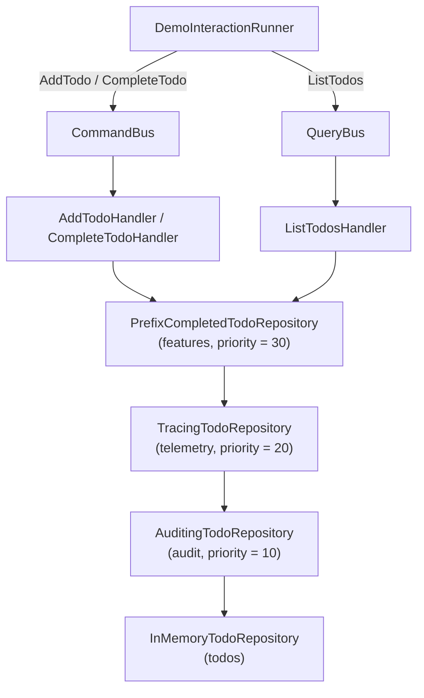

# modulith

A modular monolith todo application showing how independent Gradle subprojects contribute `kmpkt-di` components (`SimpleComponent` and configurable `Component<Options>`) and compose compile-time decorators around a core `TodoRepository` interface.

## Flow



## How It Works

### 1. Own the Core Domain in `todos`

The `todos` subproject defines the domain model (`TodoItem`), commands and query (`AddTodo`, `CompleteTodo`, `ListTodos`), handlers, and the `TodoRepository` port. `TodosComponent` implements `SimpleComponent` to bind `InMemoryTodoRepository` and discover the module's handlers automatically.

```kotlin
class TodosComponent : SimpleComponent {
    override fun ContainerBuilder.register() {
        service<InMemoryTodoRepository> { bind<TodoRepository>() }

        discover("io.kmpkt.example.modulith.todos") {
            services<CommandHandler<*>>()
            services<QueryHandler<*, *>>()
        }
    }
}
```

### 2. Layer Cross-Cutting Decorators from Sibling Modules

Other subprojects depend only on `todos` and wrap `TodoRepository` at compile time using `decorates<TodoRepository>(priority = ...)`. Higher priority numbers sit on the outside of the chain:

- **`audit` (`priority = 10`)**: `AuditingTodoRepository` records every `save` call to `AuditLog`.
- **`telemetry` (`priority = 20`)**: `TracingTodoRepository` records spans in `SpanRecorder` tagged with `serviceName`.
- **`features` (`priority = 30`)**: `PrefixCompletedTodoRepository` prepends a configured prefix to completed todo titles on `save`.

```kotlin
class PrefixCompletedTodoRepository(
    private val delegate: TodoRepository,
    private val prefix: String,
) : TodoRepository by delegate {
    override fun save(item: TodoItem) {
        val updated =
            if (item.completed && !item.title.startsWith(prefix)) {
                item.copy(title = "$prefix${item.title}")
            } else {
                item
            }
        delegate.save(updated)
    }
}
```

### 3. Expose Type-Safe Module DSLs

Modules that need configuration implement `Component<Options>` and provide a `ContainerBuilder` extension DSL. `FeatureFlagsComponent` only registers `PrefixCompletedTodoRepository` when `completedPrefix` is non-null, and `TelemetryComponent` lets the application toggle tracing or set `serviceName`.

```kotlin
class FeatureFlagsComponent : Component<FeatureFlagsOptions> {
    override fun defaults(): FeatureFlagsOptions = FeatureFlagsOptions()

    override fun ContainerBuilder.register(config: FeatureFlagsOptions) {
        val prefix = config.completedPrefix ?: return
        service<PrefixCompletedTodoRepository> {
            decorates<TodoRepository>(priority = 30)
            argument("prefix", literal(prefix))
        }
    }
}
```

### 4. Assemble the Runtime Without Manual Wiring

`ModulithConfiguration` lives in `runtime` and only sets module options—`TodosComponent` and `AuditComponent` are picked up automatically, and KSP generates the full decorator chain. When `DemoInteractionRunner` adds `"Ship modulith"` and completes it, `ListTodos` returns `"[DONE] Ship modulith"`, and both `AuditLog` and `SpanRecorder` capture the operation.

```kotlin
class ModulithConfiguration : Configuration<ModulithApp> {
    override fun ContainerBuilder.configure() {
        telemetry {
            serviceName = "todo-modulith"
        }
        featureFlags {
            completedPrefix = "[DONE] "
        }
    }
}
```

## Project Layout

| Module / File | Role |
| --- | --- |
| [`TodosComponent.kt`](todos/src/di/kotlin/io/kmpkt/example/modulith/todos/di/TodosComponent.kt) | Core `todos` domain, handlers, `InMemoryTodoRepository`, and component |
| [`AuditComponent.kt`](audit/src/di/kotlin/io/kmpkt/example/modulith/audit/di/AuditComponent.kt), [`AuditingTodoRepository.kt`](audit/src/main/kotlin/io/kmpkt/example/modulith/audit/outbound/audit/AuditingTodoRepository.kt) | `audit` decorator (`priority = 10`) and `AuditLog` |
| [`TelemetryComponent.kt`](telemetry/src/di/kotlin/io/kmpkt/example/modulith/telemetry/di/TelemetryComponent.kt), [`TracingTodoRepository.kt`](telemetry/src/main/kotlin/io/kmpkt/example/modulith/telemetry/outbound/telemetry/TracingTodoRepository.kt) | `telemetry` DSL, decorator (`priority = 20`), and `SpanRecorder` |
| [`FeatureFlagsComponent.kt`](features/src/di/kotlin/io/kmpkt/example/modulith/features/di/FeatureFlagsComponent.kt), [`PrefixCompletedTodoRepository.kt`](features/src/main/kotlin/io/kmpkt/example/modulith/features/outbound/feature/PrefixCompletedTodoRepository.kt) | `featureFlags` DSL and decorator (`priority = 30`) |
| [`ModulithConfiguration.kt`](runtime/src/di/kotlin/io/kmpkt/example/modulith/di/ModulithConfiguration.kt), [`DemoInteractionRunner.kt`](runtime/src/main/kotlin/io/kmpkt/example/modulith/inbound/runner/DemoInteractionRunner.kt) | Runtime DI configuration and demo runner |
| [`Main.kt`](app/src/main/kotlin/io/kmpkt/example/modulith/Main.kt), [`ModulithAppTest.kt`](app/src/test/kotlin/io/kmpkt/example/modulith/ModulithAppTest.kt) | Application entrypoint and test |

## Running & Testing

```bash
./gradlew :examples:modulith:app:test
```
