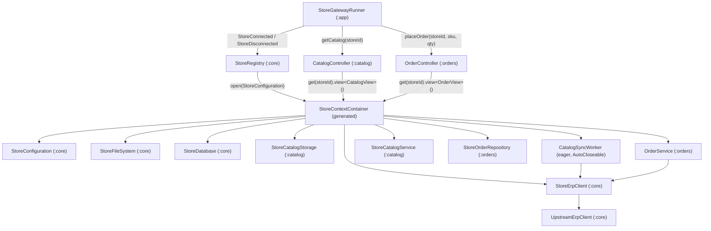

# scoped-contexts

A multi-module retail store backend example built with `kmpkt-di` demonstrating runtime-configured, isolated child containers shared across independent feature modules.

## Problem

Modular applications often manage runtime contexts that start and stop on external events. Each active context needs isolated state, configuration, and background workers, while still sharing root singletons.

Passing a central context object through every service call creates a god class. Adding every feature's services to one shared handle interface couples `:core` to every feature module.

With `kmpkt-di`, `:core` manages only the context lifecycle. Feature modules register their own scoped services into `context<M> { ... }` via `SimpleComponent` and project the active handle onto small `view<V>()` interfaces.

This example shows the pattern using a multi-store retail backend (`StoreContext`) with two independent features: `:catalog` (`CatalogView`) and `:orders` (`OrderView`).

## Modules

- **`:examples:scoped-contexts:core`**: Owns the `StoreContext` marker, `StoreConfiguration`, `StoreRegistry`, `StoreContextComponent`, `StoreFileSystem`, `StoreDatabase`, `StoreErpClient`, and `UpstreamErpClient`. Has no dependencies on feature modules.
- **`:examples:scoped-contexts:catalog`**: Depends only on `:core` (ERP to store to mobile POS). Contributes `StoreCatalogStorage`, an eager `AutoCloseable` `CatalogSyncWorker`, `StoreCatalogService`, and `CatalogView`.
- **`:examples:scoped-contexts:orders`**: Depends only on `:core` (mobile POS to store to ERP). Contributes `StoreOrderRepository`, `OrderService`, and `OrderView`.
- **`:examples:scoped-contexts:app`**: Application wiring (`ScopedContextsConfiguration`), `StoreGatewayRunner`, `main`, and tests.

## Flow



## How It Works

### 1. `:core` Defines the Context Lifecycle and Store-Scoped Infrastructure

`StoreContext` implements `KmpKtContext` as a type-safe key across modules. `StoreContextComponent` declares `context<StoreContext, StoreConfiguration>` and registers store-scoped `StoreFileSystem`, `StoreDatabase`, and `StoreErpClient` factories from `StoreConfiguration`. Feature services never inject `StoreConfiguration` themselves. `StoreRegistry` opens, idempotently reuses, replaces on config changes, and closes `ContextHandle<StoreConfiguration>` instances when `StoreConnected` / `StoreDisconnected` events arrive. `:core` never references `Catalog*` or `Order*` types.

```kotlin
object StoreContext : KmpKtContext

class StoreContextComponent : SimpleComponent {
    override fun ContainerBuilder.register() {
        discover("io.kmpkt.example.scoped.outbound.erp")
        discover("io.kmpkt.example.scoped.application.context")

        context<StoreContext, StoreConfiguration> {
            factory(StoreFileSystem::create)
            factory(StoreDatabase::create)
            factory(StoreErpClient::create)
        }
    }
}

class StoreRegistry(
    private val storeContext: ContextScope<StoreConfiguration, ContextHandle<StoreConfiguration>>,
) : AutoCloseable {
    private val activeContexts = ConcurrentHashMap<StoreId, ContextHandle<StoreConfiguration>>()

    fun onEvent(event: StoreEvent) {
        when (event) {
            is StoreEvent.StoreConnected -> {
                val config =
                    StoreConfiguration(
                        storeId = event.storeId,
                        erpEndpoint = event.erpEndpoint,
                        storageDirectory = "/var/data/stores/${event.storeId.value}",
                        databaseSchema = "store_${event.storeId.value}",
                    )
                activeContexts.compute(event.storeId) { _, existing ->
                    when {
                        existing == null -> storeContext.open(config)
                        existing.context == config -> existing
                        else -> {
                            existing.close()
                            storeContext.open(config)
                        }
                    }
                }
            }

            is StoreEvent.StoreDisconnected -> {
                activeContexts
                    .remove(event.storeId)
                    ?.close()
            }
        }
    }

    fun get(storeId: StoreId): ContextHandle<StoreConfiguration> =
        activeContexts[storeId] ?: throw StoreNotFound(storeId)
}
```

### 2. Feature Modules Contribute Services and Declare Their Own `view<V>()`

Each feature module ships a `SimpleComponent` that extends `StoreContext` with `context<StoreContext> { ... }`.

`:catalog` registers its isolated storage, an `eager()` `AutoCloseable` sync worker (which starts immediately when a `StoreContext` opens and stops automatically on `close()`), and `CatalogView`:

```kotlin
interface CatalogView {
    val catalog: StoreCatalogService
    val syncWorker: CatalogSyncWorker
}

class CatalogComponent : SimpleComponent {
    override fun ContainerBuilder.register() {
        discover("io.kmpkt.example.scoped.catalog.inbound")

        context<StoreContext> {
            service<StoreCatalogStorage>()
            service<CatalogSyncWorker> { eager() }
            service<StoreCatalogService>()
            view<CatalogView>()
        }
    }
}
```

`:orders` knows nothing about `:catalog`, yet contributes its own `StoreOrderRepository`, `OrderService`, and `OrderView` into the exact same `StoreContext`:

```kotlin
interface OrderView {
    val orders: OrderService
}

class OrderComponent : SimpleComponent {
    override fun ContainerBuilder.register() {
        discover("io.kmpkt.example.scoped.orders.inbound")

        context<StoreContext> {
            service<StoreOrderRepository>()
            service<OrderService>()
            view<OrderView>()
        }
    }
}
```

### 3. Each Controller Pulls Out Only Its Own Slice

Controllers live in the root DI container and serve requests across all stores. At runtime, `CatalogController` and `OrderController` look up the active `ContextHandle<StoreConfiguration>` in `StoreRegistry`, project it onto their own view interface via `view<V>()`, and throw `StoreNotFound` when the store is disconnected:

```kotlin
// Inside :catalog
class CatalogController(
    private val registry: StoreRegistry,
) {
    fun getCatalog(storeId: StoreId): List<Product> =
        withStore(storeId) {
            catalog.listProducts()
        }

    private fun <R> withStore(
        storeId: StoreId,
        block: CatalogView.() -> R,
    ): R =
        registry
            .get(storeId)
            .view<CatalogView>()
            .block()
}

// Inside :orders
class OrderController(
    private val registry: StoreRegistry,
) {
    fun placeOrder(storeId: StoreId, sku: String, quantity: Int) {
        withStore(storeId) {
            orders.placeOrder(sku, quantity)
        }
    }

    private fun <R> withStore(
        storeId: StoreId,
        block: OrderView.() -> R,
    ): R =
        registry
            .get(storeId)
            .view<OrderView>()
            .block()
}
```

KSP verifies at compile time that every property on `CatalogView` and `OrderView` can be resolved inside `StoreContext`, and generates a single `StoreContextContainer` class implementing `ContextHandle<StoreConfiguration>`, `CatalogView`, and `OrderView`.

### 4. `:app` Wires the Application Runner

```kotlin
class ScopedContextsConfiguration : Configuration<ScopedContextsApp> {
    override fun ContainerBuilder.configure() {
        discover("io.kmpkt.example.scoped")
    }
}
```

## Project Layout

| Module / File | Role |
| --- | --- |
| [`core`](core/src/main/kotlin/io/kmpkt/example/scoped/application/context/StoreRegistry.kt) | `StoreContext` marker, `StoreConfiguration`, `StoreNotFound`, `StoreRegistry`, `StoreFileSystem`, `StoreDatabase`, `StoreErpClient`, `UpstreamErpClient` |
| [`catalog`](catalog/src/di/kotlin/io/kmpkt/example/scoped/catalog/di/CatalogComponent.kt) | `CatalogComponent`, `StoreCatalogStorage`, `CatalogSyncWorker`, `StoreCatalogService`, `CatalogView`, `CatalogController` |
| [`orders`](orders/src/di/kotlin/io/kmpkt/example/scoped/orders/di/OrderComponent.kt) | `OrderComponent`, `StoreOrderRepository`, `OrderService`, `OrderView`, `OrderController` |
| [`app`](app/src/di/kotlin/io/kmpkt/example/scoped/di/ScopedContextsConfiguration.kt) | `ScopedContextsConfiguration`, `StoreGatewayRunner`, `Main.kt`, `ScopedContextsAppTest.kt` |

## Running

```sh
./gradlew :examples:scoped-contexts:app:check
```
