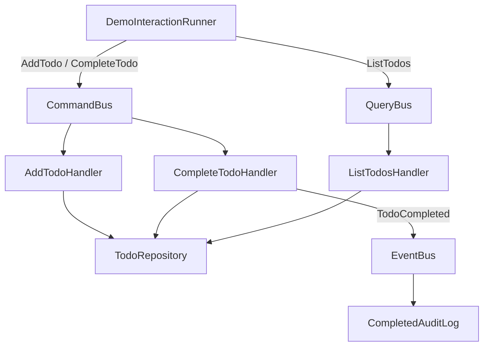

# todo-cqrs

A minimal CQRS todo application without event sourcing. It demonstrates how KmpKt separates writes (`kmpkt-command-bus`), reads (`kmpkt-query-bus`), and side effects (`kmpkt-event-bus`), with everything wired at compile time by `kmpkt-di`.

## Flow



## How It Works

### 1. Define Commands, Queries, and Events

The domain splits intentions into three distinct message types: commands that mutate state, a query that reads state, and an event that announces what happened.

```kotlin
data class AddTodo(val id: String, val title: String) : Command
data class CompleteTodo(val id: String) : Command
data object ListTodos : Query<List<TodoItem>>
data class TodoCompleted(val id: String, val title: String) : Event
```

### 2. Handle Commands and Publish Events

Each message has a dedicated handler. When `CompleteTodoHandler` marks a todo as completed, it saves the updated `TodoItem` to `TodoRepository` and publishes `TodoCompleted` on `EventBus` so subscribers like `CompletedAuditLog` can react without coupling to the write path.

```kotlin
class CompleteTodoHandler(
    private val repository: TodoRepository,
    private val events: EventBus,
) : CommandHandler<CompleteTodo> {
    override suspend fun handle(command: CompleteTodo) {
        val current = repository.find(command.id) ?: error("Todo ${command.id} not found")
        if (!current.completed) {
            repository.save(current.copy(completed = true))
            events.publish(TodoCompleted(id = current.id, title = current.title))
        }
    }
}
```

### 3. Wire Everything at Compile Time

`TodoCqrsConfiguration` binds `InMemoryTodoRepository` to the `TodoRepository` port, registers `CompletedAuditLog`, and uses `discover(...)` so KSP automatically finds all command, query, and event handlers along with `DemoInteractionRunner`.

```kotlin
class TodoCqrsConfiguration : Configuration<TodoApp> {
    override fun ContainerBuilder.configure() {
        service<InMemoryTodoRepository> { bind<TodoRepository>() }
        service<CompletedAuditLog>()

        discover("io.kmpkt.example.todo.cqrs") {
            services<CommandHandler<*>>()
            services<QueryHandler<*, *>>()
            services<EventHandler<*>>()
        }
    }
}
```

### 4. Run the Walkthrough

`Main.kt` boots the application via `KmpKt.run<TodoApp>(args)`, which executes `DemoInteractionRunner`. The runner adds two todos, completes the first one, queries `ListTodos`, and verifies that `CompletedAuditLog` recorded the completion event.

```kotlin
commands.dispatch(AddTodo(id = "1", title = firstTitle))
commands.dispatch(AddTodo(id = "2", title = "Write tests"))
commands.dispatch(CompleteTodo(id = "1"))

val items = queries.ask(ListTodos)
```

## Project Layout

| File | Role |
| --- | --- |
| [`TodoItem.kt`](core/src/main/kotlin/io/kmpkt/example/todo/cqrs/domain/model/TodoItem.kt) | Domain model (`id`, `title`, `completed`) |
| [`AddTodo.kt`](core/src/main/kotlin/io/kmpkt/example/todo/cqrs/domain/command/AddTodo.kt), [`CompleteTodo.kt`](core/src/main/kotlin/io/kmpkt/example/todo/cqrs/domain/command/CompleteTodo.kt) | Write commands |
| [`ListTodos.kt`](core/src/main/kotlin/io/kmpkt/example/todo/cqrs/domain/query/ListTodos.kt) | Read query returning `List<TodoItem>` |
| [`TodoCompleted.kt`](core/src/main/kotlin/io/kmpkt/example/todo/cqrs/domain/event/TodoCompleted.kt) | Domain event published on completion |
| [`AddTodoHandler.kt`](core/src/main/kotlin/io/kmpkt/example/todo/cqrs/application/handler/AddTodoHandler.kt), [`CompleteTodoHandler.kt`](core/src/main/kotlin/io/kmpkt/example/todo/cqrs/application/handler/CompleteTodoHandler.kt), [`ListTodosHandler.kt`](core/src/main/kotlin/io/kmpkt/example/todo/cqrs/application/handler/ListTodosHandler.kt) | Command and query handlers |
| [`InMemoryTodoRepository.kt`](core/src/main/kotlin/io/kmpkt/example/todo/cqrs/outbound/persistence/InMemoryTodoRepository.kt), [`CompletedAuditLog.kt`](core/src/main/kotlin/io/kmpkt/example/todo/cqrs/outbound/audit/CompletedAuditLog.kt) | Outbound persistence and event subscriber |
| [`TodoCqrsConfiguration.kt`](core/src/di/kotlin/io/kmpkt/example/todo/cqrs/di/TodoCqrsConfiguration.kt) | Compile-time DI configuration |
| [`DemoInteractionRunner.kt`](core/src/main/kotlin/io/kmpkt/example/todo/cqrs/inbound/runner/DemoInteractionRunner.kt) | End-to-end demo runner |
| [`Main.kt`](app/src/main/kotlin/io/kmpkt/example/todo/cqrs/Main.kt), [`TodoAppTest.kt`](app/src/test/kotlin/io/kmpkt/example/todo/cqrs/TodoAppTest.kt) | Application entrypoint and test |

## Running & Testing

```bash
./gradlew :examples:todo-cqrs:app:test
```
