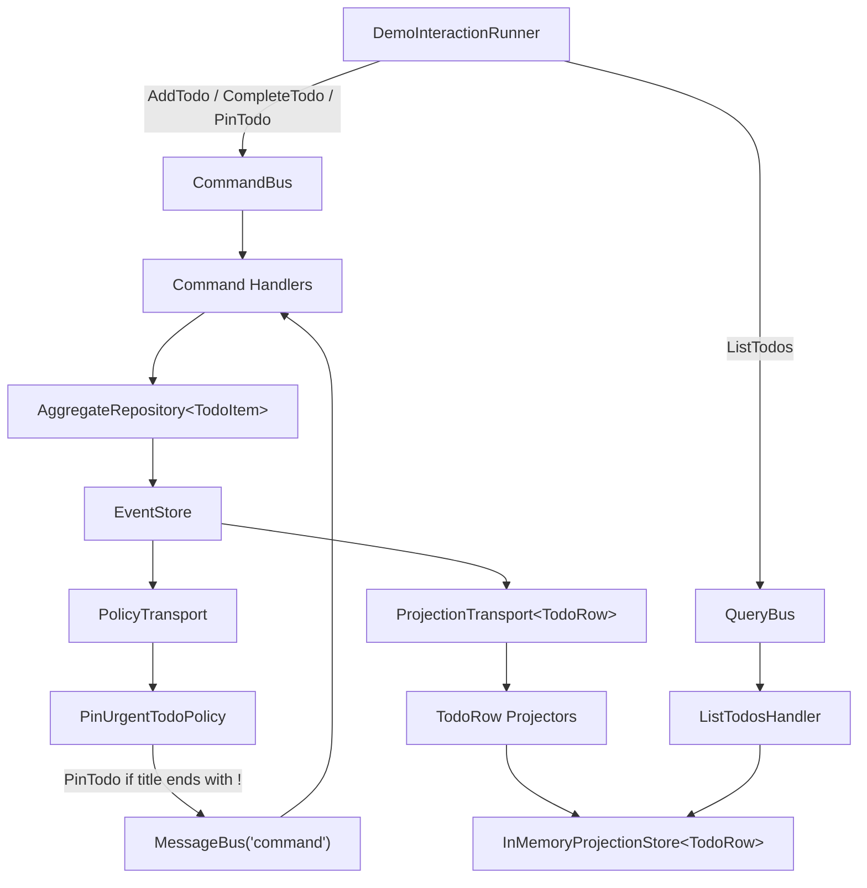

# todo-event-sourced

An event-sourced CQRS todo application built with `kmpkt-aggregate`, `kmpkt-event-store`, `kmpkt-policy`, `kmpkt-projection`, `kmpkt-serialization-kotlinx`, and `kmpkt-di`. Instead of overwriting rows in place, every state change is recorded as an immutable domain event that drives both reactive policies and read-model projections.

## Flow



## How It Works

### 1. Model State as an Event-Sourced Aggregate

`TodoItem` extends `BaseAggregateRoot<TodoItem>`. Calling `create`, `complete`, or `pin` does not mutate fields directly; it records a `TodoEvent` (`TodoAdded`, `TodoCompleted`, or `TodoPinned`), and `updateState` replays those events to rebuild state from history.

```kotlin
class TodoItem internal constructor(
    id: AggregateId<TodoItem>,
) : BaseAggregateRoot<TodoItem>(id) {
    fun complete(clock: Clock = Clock.systemUTC()) {
        if (!completed) {
            recordThat(TodoCompleted(id, version + 1, clock.instant()))
        }
    }

    override fun updateState(event: DomainEvent<TodoItem>) {
        when (event) {
            is TodoAdded -> title = event.title
            is TodoCompleted -> completed = true
            is TodoPinned -> pinned = true
            else -> error("Unsupported event: ${event::class}")
        }
    }
}
```

### 2. React to Events with Policies and Projections

Once `AggregateRepository` persists events to `EventStore`, two independent consumers react to the stream:

- **Policies** turn domain events into follow-up commands. `PinUrgentTodoPolicy` watches `TodoAdded` and emits `PinTodo` whenever a title ends with `"!"`.
- **Projectors** maintain the queryable read model. `WhenTodoAddedProjectRow`, `WhenTodoCompletedProjectRow`, and `WhenTodoPinnedProjectRow` fold events into `TodoRow` records stored in `InMemoryProjectionStore`.

```kotlin
class PinUrgentTodoPolicy : Policy<TodoAdded> {
    override fun decide(event: TodoAdded): List<Command> =
        if (event.title.endsWith("!")) listOf(PinTodo(event.aggregate)) else emptyList()
}
```

### 3. Configure Aggregates, Projections, and Policies

`TodoEventSourcedConfiguration` registers the `todo_item` aggregate stream, the `todos` projection stream, and the policy engine, then provides the kotlinx event serializer, `TodoItemFactory`, and `todoRowStore`, and discovers all handlers, policies, and projectors.

```kotlin
aggregate {
    aggregate<TodoItem>("todo_item")
}
projection {
    projection<TodoRow>("todos")
}
policy()

factory(::todoEventSerializer)
service<TodoItemFactory> { bind<AggregateFactory<TodoItem>>() }
factory(::todoRowStore) {
    bind<ProjectionStore<TodoRow>>()
    bind<ProjectionView<TodoRow>>()
}
```

### 4. Drain Queues and Query the Read Model

`DemoInteractionRunner` dispatches `AddTodo` for `"Pay rent!"` and `"Buy milk"`, completes `"Buy milk"`, and then drains `PolicyTransport` followed by `ProjectionTransport<TodoRow>` through the `"command"` `MessageBus`. Querying `ListTodos` confirms that `"Pay rent!"` was automatically pinned by the policy while `"Buy milk"` is marked completed.

## Project Layout

| File | Role |
| --- | --- |
| [`TodoItem.kt`](core/src/main/kotlin/io/kmpkt/example/todo/es/domain/aggregate/TodoItem.kt), [`TodoItemFactory.kt`](core/src/main/kotlin/io/kmpkt/example/todo/es/domain/aggregate/TodoItemFactory.kt) | Event-sourced aggregate and hydration factory |
| [`TodoEvent.kt`](core/src/main/kotlin/io/kmpkt/example/todo/es/domain/event/TodoEvent.kt) | Sealed domain event hierarchy (`TodoAdded`, `TodoCompleted`, `TodoPinned`) |
| [`AddTodo.kt`](core/src/main/kotlin/io/kmpkt/example/todo/es/domain/command/AddTodo.kt), [`CompleteTodo.kt`](core/src/main/kotlin/io/kmpkt/example/todo/es/domain/command/CompleteTodo.kt), [`PinTodo.kt`](core/src/main/kotlin/io/kmpkt/example/todo/es/domain/command/PinTodo.kt) | Write commands and their handlers in `application/handler/` |
| [`PinUrgentTodoPolicy.kt`](core/src/main/kotlin/io/kmpkt/example/todo/es/application/policy/PinUrgentTodoPolicy.kt) | Reactive policy that auto-pins urgent todos |
| [`TodoRow.kt`](core/src/main/kotlin/io/kmpkt/example/todo/es/application/projection/TodoRow.kt), [`WhenTodoAddedProjectRow.kt`](core/src/main/kotlin/io/kmpkt/example/todo/es/application/projection/WhenTodoAddedProjectRow.kt) | Read-model row and event projectors |
| [`TodoEventSerializer.kt`](core/src/main/kotlin/io/kmpkt/example/todo/es/outbound/serialization/TodoEventSerializer.kt), [`TodoRowStore.kt`](core/src/main/kotlin/io/kmpkt/example/todo/es/outbound/persistence/TodoRowStore.kt) | Outbound kotlinx serializer and in-memory projection store |
| [`TodoEventSourcedConfiguration.kt`](core/src/di/kotlin/io/kmpkt/example/todo/es/di/TodoEventSourcedConfiguration.kt) | Compile-time DI configuration |
| [`DemoInteractionRunner.kt`](core/src/main/kotlin/io/kmpkt/example/todo/es/inbound/runner/DemoInteractionRunner.kt) | End-to-end demo runner |
| [`Main.kt`](app/src/main/kotlin/io/kmpkt/example/todo/es/Main.kt), [`TodoAppTest.kt`](app/src/test/kotlin/io/kmpkt/example/todo/es/TodoAppTest.kt) | Application entrypoint and test |

## Running & Testing

```bash
./gradlew :examples:todo-event-sourced:app:test
```
