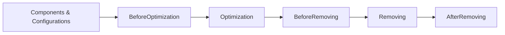

# kmpkt-di-compiler-api

Pure-Kotlin container model, component SPI, and multi-phase compilation pipeline for KmpKt compile-time dependency injection. Provides the DSL and intermediate representation shared between `src/di/kotlin` companion sources and `kmpkt-di-compiler` without depending on KSP.

## Building Blocks

### Component & Configuration SPI

| Symbol | Description |
| --- | --- |
| `Component` | Feature-module SPI declaring required components, default options, pre-configuration hooks, and service registrations. |
| `SimpleComponent` | Convenience `Component<Unit>` base interface for modules without configuration options. |
| `Configuration` | Application-level entry point for configuring component options and overriding service bindings for a `KmpKtApplication`. |
| `Tag` | Marker interface for service metadata with an integer `priority` ordered highest-first. |
| `ApplicationRunnerTag` | Built-in `Tag` applied automatically to `io.kmpkt.di.ApplicationRunner` services. |

### Container Model & DSL

| Symbol | Description |
| --- | --- |
| `ContainerBuilder`, `@ContainerDsl` | Mutable container builder and DSL scope for registering services, factories, external bindings, discovery packages, autoconfiguration rules, and passes. |
| `DefinitionConfigurator`, `DiscoveryBuilder`, `AutoconfigureBuilder`, `TaggedService`, `EntryPoint` | DSL configurators for tailoring service definitions, package scanning, autoconfiguration, tagged queries, and root entry points. |
| `ServiceId`, `ServiceKey`, `ServiceDefinition`, `TypedArgument`, `Scope`, `Decoration`, `Instantiation` | Core intermediate representation for service identities, scopes (`Shared`, `Prototype`), decorators, and instantiation strategies. |
| `Argument`, `ServiceReference`, `OnMissing`, `ConstValue` | Argument and constant value model, paired with DSL helpers `service`, `tagged`, `literal`, `env`, and `classLiteral`. |
| `TypeRef`, `TypeArgument`, `typeRef` | Name-based type representation independent of KSP and `KClass`. |
| `TypeOracle`, `ClassInfo`, `ClassTrait`, `Parameter`, `Diagnostics`, `CollectingDiagnostics` | Type-resolution and diagnostic reporting abstractions used during compilation. |

### Compiler Pipeline

| Symbol | Description |
| --- | --- |
| `BuilderPass` | Functional interface for inspecting or rewriting a `ContainerBuilder` during compilation. |
| `PassPhase` | Ordered compilation phases: `BeforeOptimization`, `Optimization`, `BeforeRemoving`, `Removing`, and `AfterRemoving`. |
| `ContainerCompiler`, `CompiledContainer`, `ResolvedEntryPoint` | Executes components in topological order, applies configurations, runs passes by phase and priority, and emits the compiled container. |

## Installation

Add the dependency in `build.gradle.kts` (the `io.kmpkt.di` Gradle plugin adds this to the `di` source set automatically):

```kotlin
dependencies {
    implementation("io.kmpkt:kmpkt-di-compiler-api:0.1.0")
}
```

## Usage

Implement `Configuration<App>` in `src/di/kotlin` to discover packages and configure services using `ContainerBuilder`:

```kotlin
import io.kmpkt.di.KmpKtApplication
import io.kmpkt.di.compiler.Configuration
import io.kmpkt.di.compiler.ContainerBuilder
import io.kmpkt.di.compiler.env

object App : KmpKtApplication

class AppConfiguration : Configuration<App> {
    override fun ContainerBuilder.configure() {
        discover("com.example.app")
        service<AppConfig> {
            argument("port", env("PORT", 8080))
        }
    }
}
```

## Container DSL

Inside `Component.register()` and `Configuration.configure()`, `ContainerBuilder` defines what services exist and how they are wired.

### Registering Services

- **`service`** wires a class through its public primary constructor. Services are shared and eager by default.
- **`factory`** calls a top-level function or an `object` factory method instead of a public constructor, which lets modules keep implementations `internal`.
- **`external`** declares a dependency passed into the generated container constructor at runtime, such as runtime configuration or database connections.

```kotlin
service<OrderService>()

factory(::createOrderRepository)
factory<OrderClock>("com.example.orders", "systemClock") // overloaded factory

external<AppConfig>() // passed as appConfig to the generated container
```

### Discovering Packages

`discover` scans a package prefix for constructible classes. By default, discovered classes stay lazy and are only checked when reachable from an entry point. Adding `services<T>()` limits discovery to subtypes of `T` and enforces strict compile-time wiring.

```kotlin
discover("com.example.orders") {
    services<CommandHandler<*>>()
    exclude<LegacyOrderHandler>()
}
```

### Binding, Decoration and Lifecycles

Every `service`, `factory` and `external` block configures a `DefinitionConfigurator`:

```kotlin
service<CachingOrderRepository> {
    decorates<OrderRepository>(priority = 10)
}

service<PrimaryDataSource> {
    bind<DataSource>()
}

factory<DataSource>(::createReplicaDataSource) {
    named("replica") // autowires parameters named `replica: DataSource`
}

service<DefaultBus> {
    argument<List<Middleware>>(tagged<MiddlewareTag>())
    argument("timeout", env("BUS_TIMEOUT_MS", 5000))
    lazy()
}
```

If a decorator has multiple parameters of the decorated type, mark the wrapped one with `argument("inner", Argument.Inner)`.

Additional options inside `service<T> { ... }`:

| Helper | Effect |
| --- | --- |
| `tag(tag)` | Attaches a `Tag` for `tagged<Tag>()` queries. |
| `prototype()` | Creates a new instance per consumer instead of sharing one. |
| `lazy()` / `eager()` | Instantiates on first access vs. container startup (`eager()` is default). |
| `autowired(false)` | Disables constructor autowiring when all arguments are passed manually. |
| `autoconfigured(false)` | Opts out of `autoconfigure<T>` rules. |
| `argument(...)` | Passes `service<T>()`, `tagged<Tag>()`, `env(...)`, `literal(...)`, `classLiteral<T>()` or plain constants (`String`, `Boolean`, `Number`, `Duration`, `Enum`). |

### Autoconfiguration and Component Configuration

`autoconfigure<T>` attaches tags to any service assignable to `T`, regardless of which module registered it.

Components that implement `Component<Options>` expose an options builder configured before `register()` runs. Pass both types to `configure` (the second type parameter can be shortened to `_` so Kotlin infers it), or use `prepend` to queue options ahead of existing ones:

```kotlin
autoconfigure<DomainEventHandler<*>> {
    tag(EventHandlerTag())
}

configure<MessengerComponent, MessengerOptions> {
    bus("command")
}
```

## Extending

### Feature component

Implement `Component` or `SimpleComponent` in `src/di/kotlin` to contribute module services, options and autoconfiguration rules:

```kotlin
import io.kmpkt.di.compiler.ContainerBuilder
import io.kmpkt.di.compiler.SimpleComponent

class MetricsComponent : SimpleComponent {
    override fun ContainerBuilder.register() {
        service<MetricsRegistry>()
    }
}
```

### Application configuration

Implement `Configuration` to configure components and override bindings for a `KmpKtApplication`:

```kotlin
import io.kmpkt.di.compiler.Configuration
import io.kmpkt.di.compiler.ContainerBuilder

class AppConfiguration : Configuration<App> {
    override fun ContainerBuilder.configure() {
        discover("com.example.app")
    }
}
```

### Custom tag

Implement `Tag` to define custom metadata markers for `tagged` queries:

```kotlin
import io.kmpkt.di.compiler.Tag

data class StartupHookTag(override val priority: Int = 0) : Tag
```

### Compiler passes

`ContainerCompiler` runs `Component` registrations in dependency order (`requires`), applies `Configuration` overrides and then executes all passes across five ordered `PassPhase` stages.

In each phase, both built-in passes and custom `BuilderPass` instances registered via `addPass(pass, phase, priority)` run together, ordered highest `priority` first (defaults: `PassPhase.BeforeOptimization`, `priority = 0`):



| Phase | Built-in passes (`priority`) and custom `addPass` timing |
| --- | --- |
| `BeforeOptimization` | Built-in `autoconfigure<T>` (`100`). Ideal for custom passes that register, tag or adjust definitions before wiring starts. |
| `Optimization` | Built-in wiring: typed arguments, decorators, constructor autowiring, `tagged<Tag>()` resolution, aliases and reference checks (`0`). Use `priority > 0` to run before built-in wiring, or `< 0` right after. |
| `BeforeRemoving` | No built-in passes. Runs after all wiring and reference checks, before unreachable services are removed. |
| `Removing` | Built-in cleanup: removes unused services, reports definition errors and inlines single-use definitions (`0`). |
| `AfterRemoving` | No built-in passes. Final inspection of the pruned container graph right before code generation. |

Inside a `BuilderPass`, inspect or rewrite definitions with `find<T>()`, `tagged<Tag>()`, `update<T>()`, `remove(id)` and `alias(key, id)`:

```kotlin
import io.kmpkt.di.compiler.BuilderPass
import io.kmpkt.di.compiler.PassPhase

val auditPass = BuilderPass { container ->
    container.tagged<StartupHookTag>().forEach { entry ->
        // inspect or update entry.definition
    }
}
addPass(auditPass, PassPhase.BeforeOptimization, priority = 10)
```
